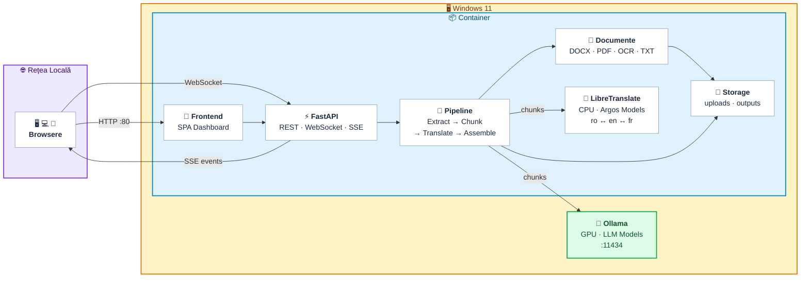
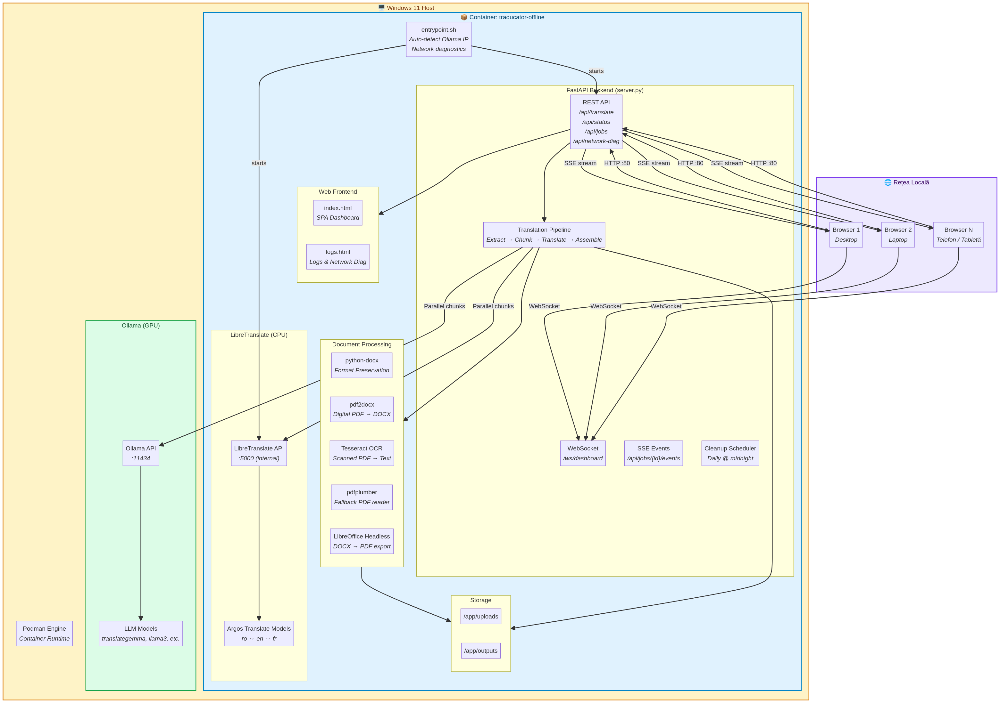

# Traducător Offline

O aplicație de traducere a documentelor care poate rula direct cu Python sau într-un container pe Windows. După instalarea dependențelor și a modelelor, poate funcționa offline. Oferă o interfață web accesibilă în rețeaua locală și suportă multiple motoare de traducere și formate de documente, cu accent pe păstrarea formatării.

## Acces și pornire

Aplicația solicită autentificare pentru interfață, documente, istoric, API, SSE și WebSocket. Utilizatorul este **`translator`**, iar parola este comună pentru utilizatorii autorizați din LAN. Aceștia partajează aceleași documente și operații; nu există conturi sau spații separate per utilizator.

La prima pornire cu `traducator_manager.bat`, helper-ul **`configure_access.ps1`** solicită parola mascat, cu confirmare și minimum 12 caractere. Managerul o înregistrează ca secret Podman, fără a o transmite în argumentele proceselor. Fișierul local `translator-password.txt` are permisiuni restrânse și nu trebuie distribuit împreună cu aplicația. Containerul primește secretul prin `TRANSLATOR_PASSWORD_FILE=/run/secrets/translator-password`.

Pentru pornire manuală sau dezvoltare, configurează **`TRANSLATOR_PASSWORD_FILE`** către un fișier protejat care conține parola, ori **`TRANSLATOR_PASSWORD`** prin mecanismul de secrete al mediului. Nu introduce parola în repository. Fără o parolă configurată, accesul este refuzat; containerul nu pornește serviciile anonime. Browserul solicită utilizatorul și parola, iar sesiunea este valabilă până la 8 ore. Folosește HTTPS printr-un reverse proxy dacă rețeaua nu este complet de încredere: autentificarea Basic pe HTTP nu criptează parola sau documentele în tranzit.

Adresele motoarelor permise sunt cele configurate la pornire prin `OLLAMA_URL` și `LIBRETRANSLATE_URL`. Pentru destinații suplimentare, administratorul setează **`TRANSLATOR_ALLOWED_ENGINE_URLS`** ca listă de origini separate prin virgulă, de exemplu `http://server-llm:11434,http://server-traduceri:5000`. Nu sunt acceptate căi, parametri, fragmente, credențiale în URL sau redirecționări. Interfața nu poate extinde această listă.

Endpoint-ul public **`/healthz`** returnează doar disponibilitatea minimă: HTTP 200 când accesul și motorul selectat sunt pregătite, respectiv 503 când nu sunt. Detaliile din `/api/status` necesită autentificare.

## Inițializare și pornire directă pe Windows, cu Python

Pentru rularea fișierului **`app/server.py`** pe calculatorul tău, folosește **`initializare.bat`** la prima configurare și **`pornire.bat`** la pornirile următoare. Acestea funcționează din folderul repository-ului, fără drepturi de administrator. `initializare.py` este asistentul de configurare; `app/manager_client.py` este doar utilitarul managerului Podman și nu pornește aplicația.

### 1. Pregătește Python și motorul de traducere

Instalează Python (recomandat **3.11**, cu Python Launcher), apoi deschide un terminal în folderul aplicației. Pentru o instalare separată de celelalte programe Python:

```powershell
py -3.11 -m venv .venv
.\.venv\Scripts\python.exe -m pip install fastapi "uvicorn[standard]" python-multipart python-docx docxcompose==2.2.0 pdfplumber aiohttp psutil websockets pdf2docx pdf2image pytesseract Pillow
```

Pentru **Ollama**, instalează și pornește Ollama pe calculatorul care va executa traducerile. Descarcă modelul ales cât timp ai internet, de exemplu:

```powershell
ollama pull translategemma
```

Adresa pentru Ollama pe același calculator este `http://127.0.0.1:11434`. Dacă alegi **LibreTranslate**, acesta trebuie să ruleze separat la adresa configurată, cu limbile necesare instalate. Pornirea `server.py` nu pornește niciunul dintre aceste motoare. Verificarea traducerilor cu LLM necesită Ollama chiar dacă traducerea folosește LibreTranslate.

Pentru OCR instalează și **Tesseract** (inclusiv limbile OCR dorite) și **Poppler**, cu executabilele în `PATH`. Pentru export DOCX → PDF instalează **LibreOffice**, cu comanda `libreoffice` sau `soffice` disponibilă în `PATH`. Aceste programe sunt suplimentare pachetelor Python; inițializarea nu le instalează și nu descarcă modele.

### 2. Rulează inițializarea interactivă

Dublu-click pe **`initializare.bat`**. Asistentul cere parola comună de minimum 12 caractere, cu introducere mascată și confirmare, apoi motorul, adresele, modelul, portul și celelalte setări. Apasă Enter pentru a accepta valorile propuse. La reconfigurare poți păstra parola existentă fără să fie afișată.

Setările sunt salvate în **Environment Variables → User variables**, pentru contul Windows curent, nu în System variables:

| Variabilă | Rol / valoare inițială |
| --- | --- |
| `TRANSLATOR_PASSWORD` | Parola comună aleasă interactiv; fără parolă implicită. Utilizatorul de autentificare este fix: `translator`. |
| `TRANSLATE_ENGINE` | `ollama` sau `libretranslate`; propune `ollama`. |
| `OLLAMA_URL` | Adresa Ollama: `http://127.0.0.1:11434`. Pentru alt calculator, introdu adresa lui accesibilă serverului. |
| `OLLAMA_MODEL` | Modelul implicit de traducere: `translategemma`; trebuie să existe în Ollama. |
| `LIBRETRANSLATE_URL` | Adresa LibreTranslate: `http://127.0.0.1:5000`. |
| `PORT` | Portul interfeței web: `8080`. |
| `INSTALLED_LANGUAGES` | Limbile așteptate de la LibreTranslate: `en,ro`. Lista trebuie să corespundă instalării motorului. |
| `FILE_RETENTION_HOURS` | Retenția fișierelor inactive: `24` de ore. |
| `TRANSLATOR_ALLOWED_ENGINE_URLS` | Origini suplimentare permise, separate prin virgulă; implicit fără destinații suplimentare. Adresele celor două motoare de mai sus sunt deja permise. |

Adresele trebuie să fie origini HTTP(S), fără `/api`, cale, parametri sau credențiale. Scriptul validează valorile înainte de salvare și nu introduce parola în argumentele comenzilor sau în repository. Aceste variabile configurează pornirea directă pe Windows; nu modifică mediul unui container Podman/Docker deja creat.

**Configurări anterioare:** `TRANSLATOR_PASSWORD_FILE` are prioritate față de parola directă. Asistentul anunță și elimină vechea setare din User variables când salvează parola directă. Dacă această variabilă există în System variables, inițializarea se oprește și indică remedierea; nu modifică variabilele de sistem. Nu trebuie creată o variabilă pentru numele utilizatorului.

### 3. Pornește aplicația

După configurare poți porni aplicația din asistent. Ulterior folosește **`pornire.bat`**: citește variabilele salvate pentru contul tău și pornește `app/server.py` cu același interpretor Python. Folosește prioritar `.venv\Scripts\python.exe`, dacă există, apoi Python Launcher sau `python` din `PATH`.

Deschide **http://localhost:8080** (sau portul ales) și autentifică-te cu utilizatorul **`translator`** și parola configurată. Pentru acces LAN, ceilalți utilizatori folosesc `http://ADRESA-IP-A-CALCULATORULUI:PORT`, cu același utilizator și aceeași parolă; accesul depinde și de regulile Windows Firewall. Păstrează fereastra serverului deschisă.

La schimbarea setărilor, închide serverul curent și pornește-l din nou. `pornire.bat` preia valorile actuale chiar dacă terminalul sau Explorer au moștenit un mediu vechi. Pentru dublu-click direct pe `app/server.py`, Windows trebuie să fi propagat deja noile variabile; dacă mesajul „Acces neconfigurat” persistă, folosește `pornire.bat`.

Indicatorul **Ollama** din stânga verifică adresa Ollama selectată în Setări și rămâne separat de alegerea motorului de traducere. Setările salvate anterior în browser au prioritate față de valorile inițiale ale serverului; dacă ai schimbat adresa în inițializare, actualizeaz-o și în Setări. O conexiune reușită la Ollama nu confirmă că un anumit model a fost descărcat.

## Arhitectura Sistemului

Soluția este construită pe o arhitectură modulară, centrată în jurul unui container Podman/Docker care rulează pe o mașină gazdă Windows. Această abordare asigură portabilitate maximă și un mediu de rulare izolat și consistent.



<details><summary>📷 Versiune statică (PNG)</summary>



</details>

### Componente Cheie

| Strat           | Componentă                  | Tehnologie / Rol                                                                                                                                                           |
| --------------- | --------------------------- | -------------------------------------------------------------------------------------------------------------------------------------------------------------------------- |
| **Gazdă Windows** | **Podman Engine**           | Rulează și gestionează ciclul de viață al containerului.                                                                                                                   |
|                 | **Ollama (GPU)**            | (Opțional) Rulează pe gazdă pentru a oferi acces la modele lingvistice mari (LLM) accelerate hardware (GPU), asigurând traduceri de calitate superioară. Ascultă pe portul `11434`. |
| **Container**   | **entrypoint.sh**           | Script de pornire care efectuează diagnosticări de rețea și detectează automat adresa IP a serviciului Ollama de pe gazdă.                                                |
|                 | **FastAPI Backend**         | Nucleul aplicației, scris în Python. Expune un API REST, gestionează joburile de traducere, monitorizează sistemul și comunică în timp real cu frontendul.                     |
|                 | **Web Frontend**            | O interfață single-page (SPA) construită cu HTML/CSS/JS vanilla. Permite încărcarea fișierelor, monitorizarea progresului și configurarea joburilor.                         |
|                 | **LibreTranslate (CPU)**    | Motor de traducere integrat în container, bazat pe Argos Translate. Oferă traduceri rapide, eficiente pe CPU, pentru limbile pre-instalate (ro, en, fr).                    |
|                 | **Document Processing**     | O suită de unelte pentru procesarea documentelor: **python-docx** (păstrarea formatării DOCX), **pdf2docx** (conversie PDF digital), **Tesseract OCR** (extragere text din PDF scanat). |
|                 | **Storage**                 | Două directoare interne (`/app/uploads`, `/app/outputs`) pentru stocarea temporară a fișierelor originale și a celor traduse.                                               |

### Flux de Traducere

1.  **Upload**: Un utilizator încarcă un document (DOCX, PDF, TXT) prin interfața web.
2.  **Creare Job**: Backend-ul FastAPI primește fișierul, creează un job unic și îl adaugă la coadă.
3.  **Extragere Text**: Pipeline-ul de traducere determină tipul fișierului:
    *   **DOCX**: Textul este extras segmentat din corp, tabele, antete și subsoluri, păstrând referințe la structură, hyperlinkuri și formatare.
    *   **PDF Digital**: Fișierul este convertit în DOCX folosind `pdf2docx` pentru a păstra layout-ul, apoi este tratat ca un fișier DOCX.
    *   **PDF Scanat sau Mixt**: Fiecare pagină este analizată separat. Paginile digitale își păstrează conversia de layout, iar cele scanate sunt citite prin Tesseract OCR; rezultatele sunt reunite în DOCX. Formatarea paginilor scanate depinde de recunoașterea OCR.
    *   **TXT**: Textul este citit direct.
4.  **Fragmentare (Chunking)**: Textul extras este împărțit în fragmente (chunks) optimizate pentru a fi trimise motorului de traducere.
5.  **Traducere Paralelă**: Fragmentele sunt trimise în paralel către motorul de traducere selectat (Ollama sau LibreTranslate).
6.  **Asamblare**: Răspunsurile traduse sunt colectate și asamblate într-un nou document. Pentru DOCX, textul tradus este reinserat în structura originală, păstrând formatarea — inclusiv **formatarea inline** (bold/italic/culoare aplicate pe porțiuni din mijlocul unui paragraf), nu doar formatarea întregului paragraf.
7.  **Notificare**: La finalizarea jobului, frontendul este notificat prin Server-Sent Events (SSE) și o notificare în browser este declanșată.
8.  **Download**: Utilizatorul poate descărca documentul tradus.

### Păstrarea formatării inline (DOCX)

Pentru paragrafele cu formatare mixtă (ex. un cuvânt **îngroșat** în mijlocul propoziției), aplicația grupează run-urile cu aceeași formatare și le marchează cu jetoane `⟦0⟧ ⟦1⟧…` înainte de traducere. Motorul este instruit să păstreze marcajele, iar textul tradus este redistribuit după identitatea numerică a marcajelor, inclusiv când modelul le reordonează. Imaginile și elementele non-text nu sunt șterse la înlocuirea textului, iar hyperlinkurile își păstrează adresele. Dacă motorul nu păstrează marcajele, se aplică automat un *fallback* sigur (tot textul în formatarea primului run), fără ca marcajele să apară vreodată în document.

**Prompt original TranslateGemma**: instrucțiunea de marcaje de mai sus modifică promptul trimis modelului. Pentru cazurile în care vrei fidelitate maximă față de model, există în *Setări* bifa **„Păstrează promptul original TranslateGemma"**. Când e activă (pentru Ollama, atât la documente cât și la text), modelul primește exact promptul nativ recomandat pe [pagina modelului](https://ollama.com/library/translategemma) — cu codurile de limbă și cele două linii goale, fără nicio instrucțiune de formatare. În acest mod formatarea inline NU mai este păstrată, iar la documente segmentele se traduc individual (fără batching).

### Verificare traduceri cu un al doilea LLM (review)

Pe lângă modelul de traducere, aplicația poate rula o **verificare de calitate** cu un model LLM generalist (configurabil în Setări → *Model de verificare*), tot prin Ollama. Modelul poate fi ales direct în pagina **Verifică traducere** sau în fereastra de verificare: din lista modelelor detectate ori prin introducerea manuală a numelui. Alegerea se aplică imediat; selectarea unui model din listă golește numele manual. Pentru fiecare job finalizat, butonul **„🔍 Verifică"** (pe pagina *Job-uri* și în panoul de finalizare al unei traduceri) compară fiecare segment *original ↔ traducere* și returnează un verdict structurat:

- **verdict**: `ok` / `minor` / `major`
- **scor**: 1–5
- **probleme** identificate (acuratețe, omisiuni, terminologie, gramatică, fluență)
- **propunere** de traducere îmbunătățită (unde e cazul)

Rezultatele apar într-un panou cu sumar (câte segmente OK / minore / majore, scor mediu) și carduri per segment. **Filtrarea** se poate face din meniul derulant (doar cele cu probleme / toate / doar OK / minore / majore / erori) sau direct **prin click pe badge-urile din sumar** (OK / minore / majore / erori) — badge-ul activ este evidențiat. Verificarea rulează în paralel (concurență configurabilă) și folosește `format: json` la Ollama pentru răspunsuri robuste.

**Editare manuală**: fiecare segment are un câmp **editabil** „de aplicat", precompletat cu propunerea modelului (sau cu traducerea curentă, dacă nu există propunere). Poți corecta manual orice segment, inclusiv cele marcate OK; la editare segmentul se bifează automat pentru includere. Butonul **„Copiază"** copiază textul de aplicat în clipboard (cu *fallback* automat pentru contextele non-HTTPS, ex. acces în rețeaua locală pe HTTP).

**Context la verificare**: implicit, reviewer-ul primește și **N segmente vecine din original** (dinainte și de după, configurabil 0–5 în *Setări → Model de verificare*) ca text de context — doar pentru a înțelege referințe, terminologie și ton, fără a fi evaluat. Opțional, bifa **„Include și traducerile vecine în context"** adaugă și traducerea segmentelor vecine, pentru consistență terminologică și fluență între segmente. Contextul este limitat ca dimensiune pentru a încăpea în fereastra modelului (`num_ctx`).

**Aplicarea propunerilor**: fiecare propunere/editare poate fi bifată („Aplică..."), iar butonul **„Generează document revizuit"** reconstruiește documentul înlocuind segmentele acceptate cu traducerile îmbunătățite sau editate manual. Pentru fișierele **DOCX** revizuirea se aplică peste originalul, păstrând formatarea — inclusiv cea **inline** (reviewer-ul primește traducerea cu marcaje `⟦n⟧` și le păstrează în propunere, astfel încât bold/italic/culoarea se reaplică și pe textul îmbunătățit; segmentele *editate manual* nu poartă marcaje, deci pe acelea formatarea inline nu se reaplică); pentru TXT se generează textul corectat, iar pentru PDF se reutilizează DOCX-ul intermediar păstrat pentru a conserva structura și imaginile obținute la conversie. Documentul revizuit se descarcă separat (cu sufixul **`_review`** în nume, ex. `document_en_revizuit_review.docx`), fără a suprascrie traducerea inițială.

**API**: `POST /api/jobs/{id}/review` (pornire; parametri: `model`, `concurrency`, `context_window`, `context_translations` ș.a.), `GET /api/jobs/{id}/review` (progres + rezultate), `POST /api/jobs/{id}/review/cancel` (anulare), `POST /api/jobs/{id}/review/apply` (aplică propunerile/editările alese — câmpurile `indices` și `edits`), `GET /api/jobs/{id}/review/download` (descarcă documentul revizuit), `POST /api/review-text` (verificare ad-hoc a unei perechi original/traducere). Fiecare cerere de verificare apare și în istoricul „CMD" (tip `review`).

### Verificarea unei traduceri externe (tab „Verifică traducere")

Pe lângă verificarea unui job propriu, există un tab dedicat **„Verifică traducere"** pentru documente traduse **în afara aplicației**. Încarci documentul **original** și documentul **tradus** (DOCX, PDF, TXT, MD), alegi limbile, apoi apeși **„Verifică traducerea"**. PDF-urile scanate trec prin OCR. Aplicația segmentează ambele documente, **aliniază segmentele în structura documentului** (corp, tabele, antete și subsoluri, când există metadate DOCX; pe poziție pentru text simplu) și deschide direct fereastra de verificare descrisă mai sus — cu tot ce ține de ea: verdicte/scor, editare manuală, filtrare, copiere, context vecin și generarea documentului revizuit cu sufix `_review`.

- **Aliniere**: dacă cele două documente au un număr diferit de segmente, se verifică partea comună și se afișează un **avertisment**. Pentru rezultate corecte, documentele ar trebui să aibă aceeași structură (același număr de paragrafe) — cazul tipic fiind un original și traducerea lui produsă cu aceeași aplicație.
- **Tabele și editări**: verificarea include celulele, paragrafele multiple dintr-o celulă și tabelele imbricate, fără dublarea celulelor îmbinate. Modificările selectate, inclusiv editările manuale și ștergerea textului, se aplică în documentul descărcat. La verificarea unui document extern, baza este documentul **tradus** încărcat, astfel încât conținutul neselectat și segmentele suplimentare rămân intacte.
- **Reutilizare**: intern se creează un „job de verificare" (`kind = "verify"`), marcat `completed`, care folosește exact aceleași endpoint-uri de review/apply/download. Apare și în lista **„Job-uri"**, marcat cu un badge **„verificare"**. Pentru DOCX, documentul revizuit se reconstruiește peste cel tradus, păstrând formatarea (inclusiv cea inline).
- **API**: `POST /api/verify-documents` (form-data: `original`, `translated`, `source_lang`, `target_lang`) → întoarce `job_id`, numărul de segmente aliniate și un flag `mismatch`. Verificarea propriu-zisă se pornește apoi prin endpoint-urile standard `…/review`.

### Istoric traduceri („CMD")

Pagina **`/prompts.html`** expune istoricul fiecărei cereri trimise către motorul de traducere: **promptul exact trimis** și **răspunsul brut primit**, împreună cu motorul, modelul, perechea de limbi, numărul de încercări, durata și eventualele erori. Util pentru depanare și transparență. Datele sunt disponibile și prin API: `GET /api/prompts` (filtrabil după `job_id` și `engine`), `DELETE /api/prompts` pentru golire.

## Integritatea rezultatelor și gestionarea fișierelor

- Un răspuns de lot cu segmente lipsă, suplimentare sau goale declanșează traducerea individuală. Erorile de segment nu sunt transformate în documente raportate ca finalizate.
- Limita de fragmentare se aplică și propozițiilor/paragrafelor lungi. Fragmentele din același paragraf DOCX sunt reunite în poziția lor inițială.
- Anularea și ștergerea joburilor opresc și așteaptă taskurile de traducere/verificare. Curățarea nu șterge fișierele operațiilor active, inclusiv OCR.
- Curățarea programată elimină fișierele inactive mai vechi decât **`FILE_RETENTION_HOURS`** (implicit 24 de ore). Curățarea manuală elimină fișierele inactive și raportează câte fișiere active au fost păstrate.
- Managerul folosește volumele Podman **`traducator-uploads`** și **`traducator-outputs`**. Start/Oprire păstrează containerul și documentele; eliminarea unui container nu elimină aceste volume. Politica de retenție continuă să se aplice.
- Fișierele păstrate pot fi descărcate din **Loguri & Sistem**, inclusiv după repornire. Joburile, istoricul prompturilor și sesiunile de progres sunt în memorie și se resetează la repornirea procesului.
- `.dockerignore` și `.containerignore` permit numai fișierele necesare construirii imaginii. Documentele utilizatorilor, secretele și cache-urile locale sunt excluse.

## Management și Deployment

Întregul ciclu de viață al aplicației este gestionat prin două scripturi batch interactive:

-   **`builder.bat` (Stația Online)**: Construiește imaginea containerului și o exportă într-un fișier `.tar` pentru transfer.
-   **`traducator_manager.bat` (Stația Offline)**: Oferă un meniu complet pentru a încărca imaginea, a porni/opri serviciile, a vizualiza loguri și a rula diagnosticări de rețea.

Construirea instalează modelele cerute și încălzește cache-urile de segmentare. Exportul este precedat de traduceri de verificare cu rețeaua containerului oprită; o pereche lipsă sau un download necesar în acest pas oprește operația. Transferă și `configure_access.ps1` împreună cu managerul.

Încărcarea unei imagini noi nu actualizează automat un container existent. Pentru migrare și actualizare, urmează pașii de backup din tutorial; managerul refuză pornirea automată a containerelor vechi fără configurația de acces securizat.

Pentru instrucțiuni detaliate de instalare și utilizare, consultați **[TUTORIAL_DOCKER.md](TUTORIAL_DOCKER.md)**.


## Verificări de regresie

Cu dependențele Python din `Containerfile` instalate, rulează din rădăcina repository-ului:

```bash
python -m unittest discover -s tests -v
```

Testele acoperă documente/tabele/imagini/hyperlinkuri, PDF-uri mixte, validarea modelelor, autentificarea, destinațiile de rețea, uploadurile, anularea și curățarea fișierelor, precum și instalarea și startup-ul containerului.

Testele interfeței rulează separat cu Playwright și Chromium:

```bash
python tests/browser_regressions.py
```

Pentru acestea instalează pachetul Python `playwright` și browserul Chromium (ori `python -m playwright install chromium`, conform instrucțiunilor testului). Răspunsurile motoarelor sunt controlate în testele automate; calitatea traducerilor, GPU-ul și disponibilitatea unui model real trebuie verificate separat. Verificarea offline din builder folosește modelele reale incluse în imagine. Scripturile Windows trebuie validate și pe stația Windows/Podman folosită pentru distribuție.
